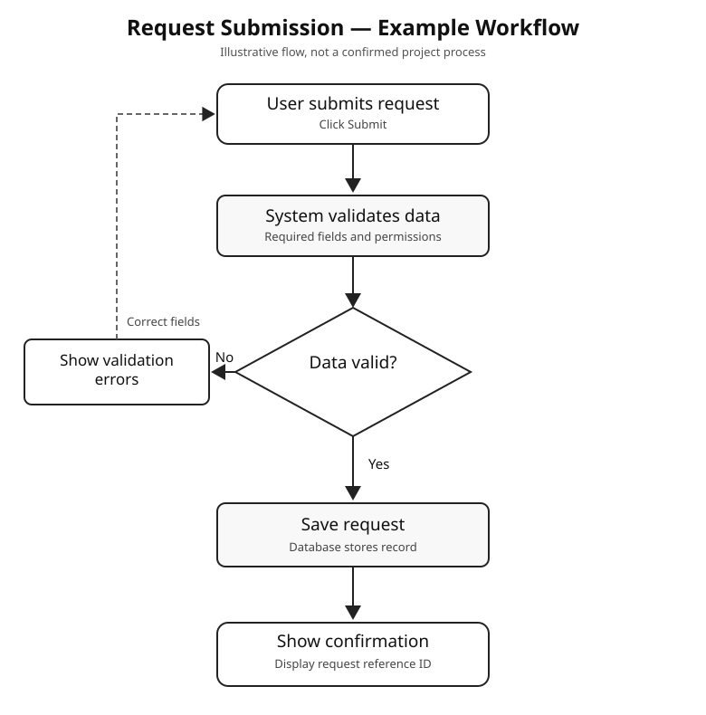
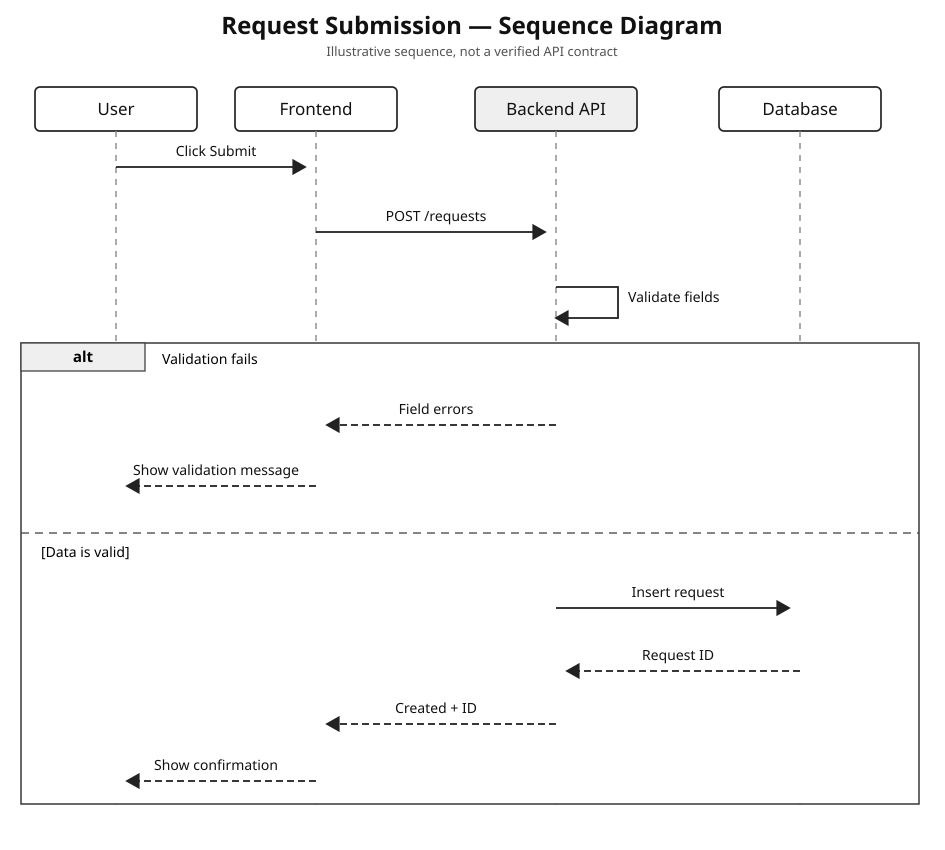
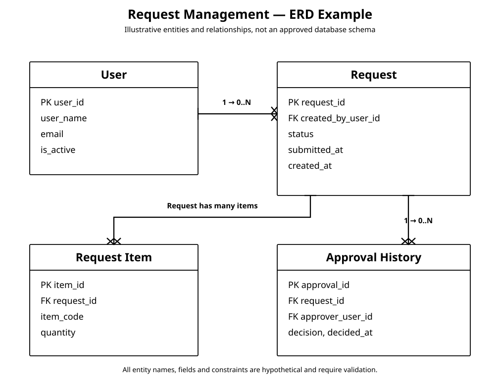

# Business & System Analysis Skill

Reusable instructions for Business Analysts and System Analysts. The repository helps AI agents produce practical requirements, workflow diagrams, sequence diagrams, Jira tickets, integration specifications, UAT scenarios, and well-formatted documentation.

**English-first documentation. Two independent skill packages: English and Indonesian.** The Indonesian edition is written for real BA/SA working language, not literal textbook-style translation. Technical terms remain in English.

[English SKILL.md](skills/system-analysis-en/SKILL.md) · [Indonesian SKILL.md](skills/system-analysis-id/SKILL.md) · [Bilingual root SKILL.md](SKILL.md)

## What is included?

- Evidence hierarchy and status labels: `Existing / Observed`, `Confirmed`, `Proposed`, and `Need Confirmation`.
- Discovery, requirement analysis, As-Is/To-Be, BPMN, swimlane, Business Rules, and Acceptance Criteria.
- API integration, sequence diagrams, webhook, timeout, idempotency, status mapping, and error handling.
- BRD, PRD, FRD, SRS, MoM, Jira, UAT, SOP, and technical documentation guidelines.
- Word/PDF layout rules with **Calibri**, **solid black #000000 text on every element**, **white full-border tables without shading**, and **actual rendered diagrams embedded in documents**.
- Natural Indonesian writing with **unchanged technical terminology**: `endpoint`, `payload`, `approval`, `validation`, `request`, `response`, `webhook`, `sequence diagram`, and actual UI names.

## Automatic full documentation for new systems

If you ask an agent to design or document a **project, application, or module from scratch**, these skills instruct it to prepare the **complete BA/SA package without being asked for each artifact**:

- Project Charter, stakeholder register, **RACI**, scope and assumptions
- **BRD, PRD and FRD/SRS** with traceable requirements and acceptance criteria
- **Rendered workflow, swimlane, sequence diagrams, ERD and architecture** where applicable
- Data dictionary, Role Permission Matrix, Business Rules, validations and state transitions
- API specification for actual integrations, UI/UX screen requirements, **UAT**, risks and decision log

Missing owner assignments, business decisions and technical contracts must be labeled **Proposed** or **Need Confirmation**, not fabricated. This mode is for substantial new-system requests, not short Jira tickets or minor revisions.

[Full greenfield documentation coverage and example ERD](docs/greenfield-documentation.md)

## Black text for Word/PDF

All text defaults to **pure black #000000**, including body, headings, captions, tables and hyperlinks. Calibri remains the default font. Tables use white cells with solid visible black full-grid borders and no shaded rows or headers. Diagrams are delivered as rendered graphics and embedded in the actual document when Word/PDF is requested.

## Diagram output means a rendered visual

A flowchart or sequence diagram request must result in an **actual graphic**, not only a Mermaid code block or process description. The skill instructs AI agents to render diagrams as SVG/PNG or another visible diagram format, then embed them directly into Word/PDF when those files are requested.

**Flowchart example**



**Sequence diagram example**



**ERD example**



[Word/PDF document rules](docs/word-pdf-style.md) · [Diagram guidelines](docs/sequence-diagrams.md)

## Quick install

Requires **Node.js 22.20.0 or later** and the [skills CLI](https://github.com/vercel-labs/skills). You do not need to install the CLI globally. `npx` runs it for you.

Choose a language and agent below. Each command installs that single skill globally for the selected agent, so you can reuse it across projects. The `--copy` option is helpful on Windows, where creating symlinks may be restricted.

### Claude Code

English:

```powershell
npx skills add https://github.com/Ducklazy231/system-analysis-skill/tree/main/skills/system-analysis-en -g -a claude-code --copy -y
```

Indonesian:

```powershell
npx skills add https://github.com/Ducklazy231/system-analysis-skill/tree/main/skills/system-analysis-id -g -a claude-code --copy -y
```

### OpenAI Codex CLI

English:

```powershell
npx skills add https://github.com/Ducklazy231/system-analysis-skill/tree/main/skills/system-analysis-en -g -a codex --copy -y
```

Indonesian:

```powershell
npx skills add https://github.com/Ducklazy231/system-analysis-skill/tree/main/skills/system-analysis-id -g -a codex --copy -y
```

### Gemini CLI

English:

```powershell
npx skills add https://github.com/Ducklazy231/system-analysis-skill/tree/main/skills/system-analysis-en -g -a gemini-cli --copy -y
```

Indonesian:

```powershell
npx skills add https://github.com/Ducklazy231/system-analysis-skill/tree/main/skills/system-analysis-id -g -a gemini-cli --copy -y
```

### Cursor

English:

```powershell
npx skills add https://github.com/Ducklazy231/system-analysis-skill/tree/main/skills/system-analysis-en -g -a cursor --copy -y
```

Indonesian:

```powershell
npx skills add https://github.com/Ducklazy231/system-analysis-skill/tree/main/skills/system-analysis-id -g -a cursor --copy -y
```

Other supported agents, including GitHub Copilot and OpenCode, and project-local installations are documented in [Installation and CLI commands](docs/installation.md).

> **ChatGPT web/app:** these CLI commands install skills for supported local coding agents, not automatically into ChatGPT web chats. To use the skill in ChatGPT, attach the selected `SKILL.md` or include its contents in a Project's instructions/files where supported.

## Verify the installation

```powershell
npx skills list -g
```

You should find `system-analysis-en` or `system-analysis-id` if installation succeeded. Restart or reload your agent session if the skill is not immediately listed by the agent.

Ask your agent to apply the installed skill explicitly, for example:

> Apply system-analysis-en. Draft an FRD for this module, covering field validation, Business Rules, Role Permission, Acceptance Criteria, and open questions.

> Gunakan system-analysis-id. Buat Jira dari case ini dengan As-Is, To-Be, dan Acceptance Criteria. Technical terms tetap English. Jangan buat intro yang terlalu formal.

## What natural Indonesian means here

**Avoid:**

> Dalam rangka meningkatkan efisiensi dan efektivitas proses bisnis, diperlukan optimalisasi mekanisme persetujuan secara komprehensif.

**Write instead:**

> Saat user klik Submit, sistem perlu menentukan approver berdasarkan role dan mengubah status request menjadi Pending Approval.

This is a *hypothetical writing example*, not a confirmed process rule.

## Repository layout

```text
.
├── README.md
├── SKILL.md
├── AGENTS.md
├── CLAUDE.md
├── skills/
│   ├── system-analysis-en/
│   │   └── SKILL.md
│   └── system-analysis-id/
│       └── SKILL.md
├── docs/
│   ├── installation.md
│   ├── usage-en.md
│   ├── anti-ai-slop-id.md
│   ├── sequence-diagrams.md
│   └── word-pdf-style.md
├── examples/
│   ├── brd-example.md
│   ├── jira-example.md
│   └── diagrams/
└── CHANGELOG.md
```

## Documentation

- [Installation & CLI](docs/installation.md)
- [English usage guide](docs/usage-en.md)
- [Indonesian anti-AI-slop rules](docs/anti-ai-slop-id.md)
- [Sequence diagrams](docs/sequence-diagrams.md)
- [Word/PDF formatting](docs/word-pdf-style.md)
- [Complete greenfield documentation blueprint](docs/greenfield-documentation.md)
- [Rendered example ERD](examples/diagrams/erd-request-management.svg)
- [BRD example](examples/brd-example.md)
- [Jira example](examples/jira-example.md)
- [Editable Mermaid diagrams](examples/diagrams/sequence-external-webhook.mmd)

## Evidence and safety

The skill provides working methods, not verified facts about a product. It must not invent business decisions, API documentation URLs, approval assignments, metrics, customer information, or test evidence. Example workflows are intentionally generic. Always use the current project's actual sources.

CLI usage and supported agent IDs follow the [skills CLI reference](https://github.com/vercel-labs/skills/blob/main/docs/commands.md) and [agent support list](https://github.com/vercel-labs/skills/blob/main/docs/agents.md). CLI behavior may change after publication.

## Version

**v1.3.0** — Strict solid-black text, full greenfield documentation mode with automatic stakeholder/BRD/PRD/ERD/UAT coverage, and rendered ERD example.
