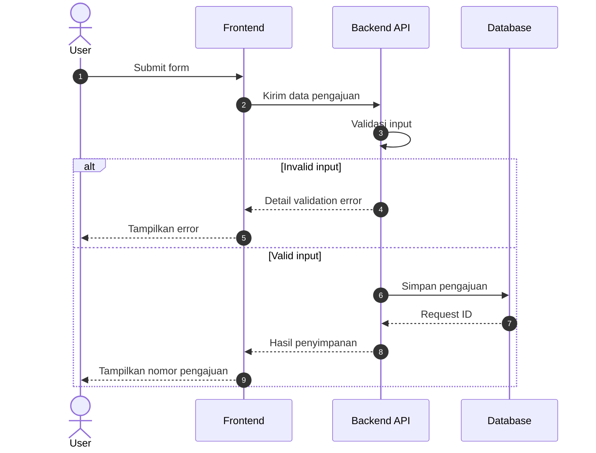

# Business & System Analysis Skill

Panduan kerja untuk AI ketika membantu Business Analyst (BA) dan System Analyst (SA). Bisa dipakai lintas proyek, dari analisis proses bisnis sampai dokumentasi teknis.

**Versi:** 1.1.0  
**Bahasa:** Bahasa Indonesia dan English  
**Instruksi utama:** [`SKILL.md`](SKILL.md)  
**English documentation:** [`README.en.md`](README.en.md)

Skill ini dibuat supaya hasil AI jelas, dapat diuji, dan siap dibahas bersama tim. Fokusnya bukan membuat dokumen panjang yang hanya terlihat formal.

## Apa yang diatur?

| Area | Cakupan |
|---|---|
| Business analysis | Discovery, stakeholder, As-Is, To-Be, gap analysis, scope, business rules |
| Dokumen kerja | BRD, PRD, FRD, SRS, MoM, Jira, SOP, UAT |
| System analysis | API integration, ERD, architecture, data flow, sequence diagram |
| Quality control | Evidence, keputusan, traceability, acceptance criteria |
| Penulisan | Anti-AI Slop Bahasa Indonesia dan English, contoh sebelum/sesudah |
| Word dan PDF | Tipografi, margin, tabel, diagram, pemenggalan halaman |

**Bukan template khusus proyek.** Nama modul, role, requirement, approval, endpoint, dan status diambil dari project yang sedang dikerjakan, bukan dari contoh di repository.

## Quick start

1. Berikan [`SKILL.md`](SKILL.md) sebagai instruksi kepada AI yang digunakan.
2. Lampirkan bahan proyek, misalnya meeting notes, requirement, screenshot, backlog, error log, atau dokumentasi API.
3. Sebutkan output, bahasa, dan format hasil yang diperlukan.

Contoh prompt:

> Gunakan SKILL.md sebagai standar analisis. Analisis kebutuhan modul Inventory dari catatan meeting berikut. Buat As-Is, To-Be, Business Rules, Field Requirements, dan Acceptance Criteria. Gunakan Bahasa Indonesia profesional yang natural. Bedakan Existing, Confirmed, Proposed, dan Need Confirmation.

Untuk Word:

> Buat hasil dalam DOCX yang bisa diedit. Gunakan format dokumen internal sederhana, tanpa cover dekoratif, tanpa header atau footer tambahan, dan pastikan tabel dapat dibaca.

Untuk Jira:

> Gunakan SKILL.md dan buat Jira ticket singkat dalam Bahasa Inggris. Isi Title, As-Is, To-Be, serta Acceptance Criteria. Jangan menambahkan root cause tanpa bukti.

Menyimpan `SKILL.md` di repository **tidak otomatis** membuat semua AI membaca isinya. Sertakan dalam project instructions atau secara eksplisit minta AI membaca file tersebut. `AGENTS.md` dan `CLAUDE.md` disiapkan sebagai petunjuk singkat untuk AI tools yang mendukung file instruksi tersebut.

## Prinsip utama

1. **Pisahkan fakta dan usulan.** Gunakan `Existing / Observed`, `Confirmed`, `Proposed`, atau `Need Confirmation` dengan tepat.
2. **Tulis sesuai pekerjaan.** Jira singkat tidak perlu pembuka panjang. BRD lengkap memerlukan detail yang lebih banyak.
3. **Utamakan requirement yang dapat diuji.** Sebut aktor, kondisi, tindakan, validasi, dan hasil.
4. **Jaga technical flow.** Response HTTP awal, perubahan state, dan webhook asynchronous bukan kejadian yang sama.
5. **Hindari AI slop.** Tidak perlu bahasa promosi, filler, heading dekoratif, atau kesimpulan tanpa fungsi.
6. **Gunakan format sederhana.** Word/PDF harus seperti dokumen internal yang mudah direvisi dan dicetak.

## Contoh Anti-AI Slop

**Tidak spesifik**

> Dalam rangka meningkatkan efisiensi operasional secara menyeluruh, dibutuhkan optimalisasi sistem inventory agar lebih terintegrasi dan user-friendly.

**Lebih jelas**

> Modul Inventory saat ini belum menyediakan filter berdasarkan lokasi gudang. User perlu membuka detail setiap barang untuk mencari stok pada gudang tertentu.

Kedua contoh adalah ilustrasi, bukan hasil observasi proyek nyata. Selengkapnya ada di [Panduan Anti-AI Slop](docs/anti-ai-slop-id.md).

## Sequence diagram

Diagram source Mermaid disediakan dalam file `.mmd` sehingga dapat diedit dan dirender di GitHub. Tiga skenario:

- [Submit form dengan validation dan database error](examples/diagrams/sequence-submit-form.mmd)
- [Approval dan rejection](examples/diagrams/sequence-approval.mmd)
- [External API dan webhook asynchronous](examples/diagrams/sequence-external-webhook.mmd)

Contoh submission singkat:



Baca [standar sequence diagram](docs/sequence-diagrams.md) untuk penjelasan participant, jenis message, error, dan async flow.

## Struktur repository

```text
business-system-analysis-skill/
├── SKILL.md
├── README.md
├── README.en.md
├── AGENTS.md
├── CLAUDE.md
├── CHANGELOG.md
├── CONTRIBUTING.md
├── docs/
│   ├── penggunaan-id.md
│   ├── usage-en.md
│   ├── anti-ai-slop-id.md
│   ├── sequence-diagrams.md
│   ├── word-pdf-style.md
│   └── github-publish.md
└── examples/
    ├── brd-example.md
    ├── jira-example.md
    └── diagrams/
        ├── sequence-submit-form.mmd
        ├── sequence-approval.mmd
        └── sequence-external-webhook.mmd
```

## Dokumen dan contoh

| Dokumen | Kegunaan |
|---|---|
| [Cara penggunaan](docs/penggunaan-id.md) | Pengaturan lintas AI dan contoh prompt |
| [English usage](docs/usage-en.md) | English setup and workflows |
| [Anti-AI Slop](docs/anti-ai-slop-id.md) | Aturan penulisan Bahasa Indonesia |
| [Sequence diagrams](docs/sequence-diagrams.md) | Standar notasi dan contoh lengkap |
| [Word/PDF formatting](docs/word-pdf-style.md) | Aturan layout dokumen kerja |
| [Publish ke GitHub](docs/github-publish.md) | Langkah upload lewat web atau Git CLI |
| [Contoh BRD](examples/brd-example.md) | Ilustrasi requirement dan keputusan |
| [Contoh Jira](examples/jira-example.md) | Ilustrasi ticket pendek dan testable |

## Batasan

Skill ini tidak mengakses sistem perusahaan atau data proyek secara otomatis. Status `Confirmed` harus berasal dari sumber yang benar. Contoh endpoint, role, status, dan field di repository bersifat hipotetis. DOCX/PDF memerlukan AI tool yang benar-benar mendukung pembuatan file. Belum ada lisensi publik yang ditetapkan untuk repository ini.