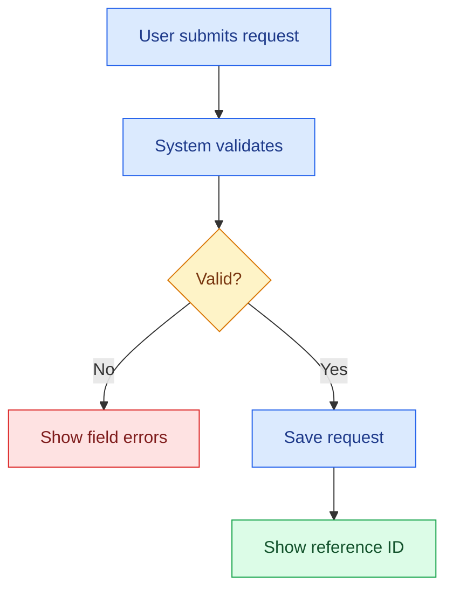
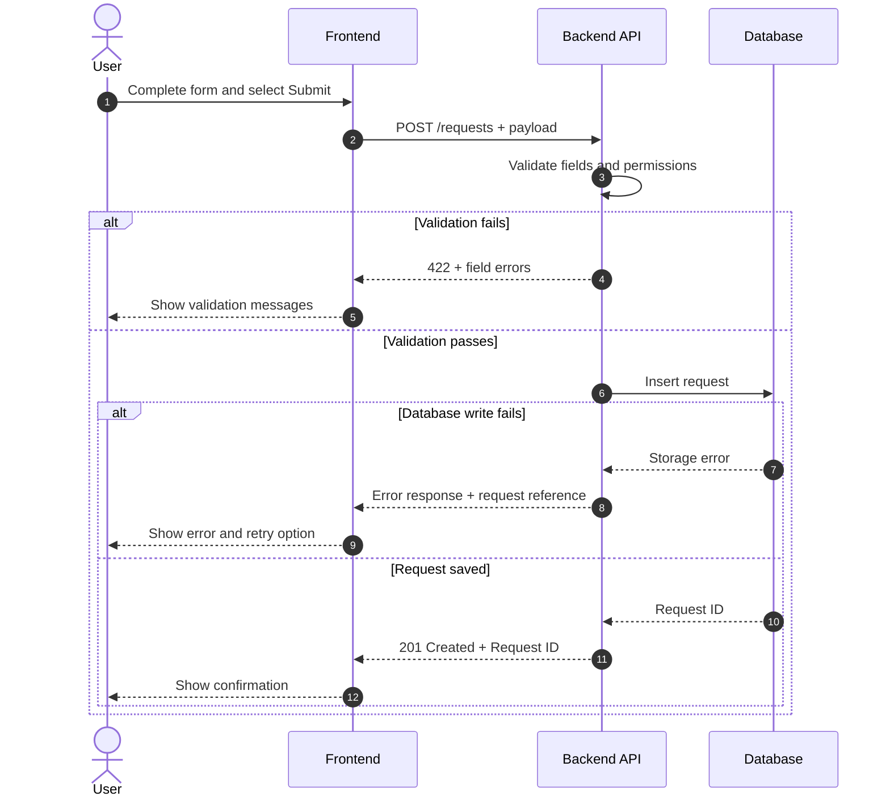
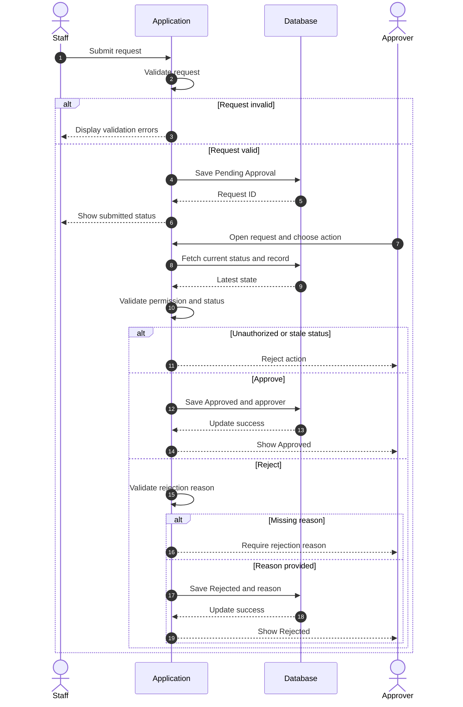
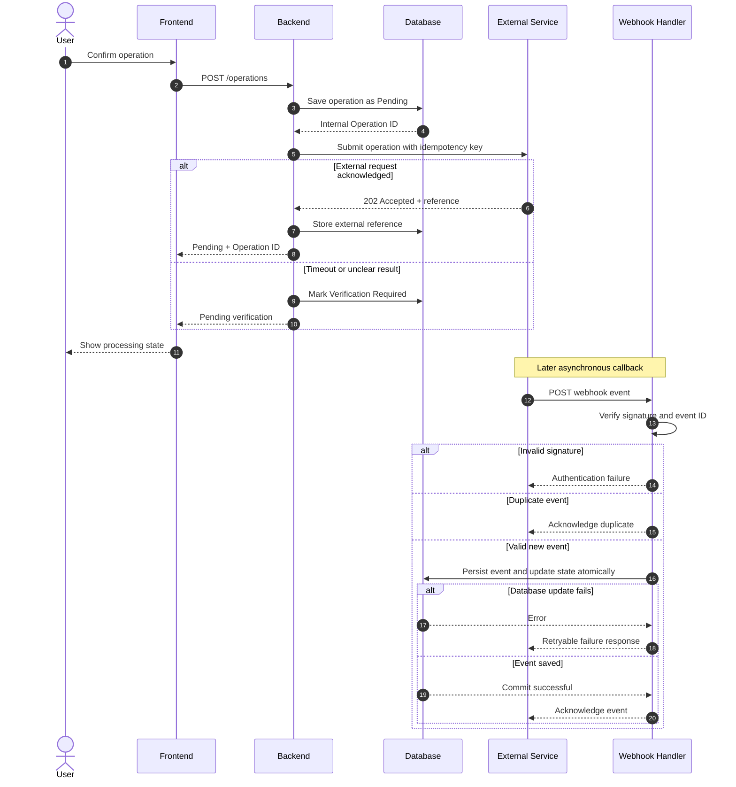

# Business & System Analysis — Bilingual Master Skill

## Language selection / Pemilihan bahasa

Use English for repository documentation and as the default writing language when the user has not specified one. If the user requests Indonesian, use natural everyday Indonesian appropriate for BA/SA work, not stiff textbook or bureaucratic language. Keep technical terms in English, including API, endpoint, payload, request, response, workflow, validation, approval, role, permission, retry, webhook, error handling, sequence diagram, and UAT. Do not translate actual UI labels.

For complete single-language instruction sets, use [English skill](skills/system-analysis-en/SKILL.md) or [Indonesian skill](skills/system-analysis-id/SKILL.md) when working from the repository. These are independently installable skill packages.

**Contoh gaya Bahasa Indonesia:** "Saat user klik Submit, backend menjalankan validation. Kalau ada field wajib yang kosong, sistem menampilkan error message. Data belum disimpan."

**Avoid:** "Dalam rangka meningkatkan efektivitas pengelolaan data, diperlukan mekanisme validasi yang komprehensif."

> Version 1.4.0. This is a reusable working standard, not a project-specific business specification. Use the user's actual source materials as evidence and preserve the terminology used by the product team.

## 0A. Default package for a new system — BRD, PRD, FSD

**Trigger:** The user asks to design or document a new system, application, project or module from scratch, or requests a complete BA/SA requirements package.

**Deliver exactly three core documents by default**: BRD, PRD and FSD. Do not produce 19 separate files. The former extended coverage list is only a completeness reference. Place stakeholders, workflows, ERD, API, permission and UAT inside the document where the material belongs. Do not ask whether to also include those components.

### 1. BRD — Business Requirements Document

**Audience:** Business Owner, Management, Process Owner and non-technical stakeholders.

**Purpose:** Explain why the business needs the change, what must change in the business process and how the outcome will be judged, without implementation details.

**Required content:** Business Background, Problem Statement, Business Objectives, Stakeholder Register (confirmed roles or proposed mapping), Scope In/Out, As-Is only if an existing process is evidenced, **rendered To-Be Business Workflow or Swimlane**, Business Requirements with IDs, Business Rules, key risks/dependencies, Business Acceptance Criteria, and Open Questions/Approval decisions.

**Do not add:** SQL, ERD, API payloads, database design or other backend implementation details.

### 2. PRD — Product Requirements Document

**Audience:** Product Owner, Product Manager, UI/UX Designer, BA/SA and planning engineers.

**Purpose:** Define what product is needed, who will use it, which features and modules exist, and what each user-facing interaction should do.

**Required content:** Product Overview, User Needs, Product Goals and Success Metrics when evidenced, Target Users/Personas/Roles, Scope and Release Priority, Module/Feature Breakdown, User Stories and Use Cases, **rendered User Journey and User Flow**, Product Behavior, UI/UX Screen Requirements, Feature Acceptance Criteria, Dependencies, Constraints, and Open Product Decisions.

**Do not add by default:** exact DB column types, SQL, raw provider API contracts, deployment configuration or detailed internal processing logic.

### 3. FSD — Functional Specification Document

**Audience:** System Analyst, Frontend, Backend, QA, Database Engineer and Technical Lead.

**Purpose:** Define how system functions behave in testable implementation detail, traceable to PRD and BRD.

**Required content:** System and Module Boundary, Functional Requirement IDs with BRD/PRD references, Actors and Roles, Detailed Functional Workflow and exception paths, **rendered Sequence Diagrams**, Screen/Field Specifications, Validation Rules, Business Logic and Calculations, Status Transitions, Role Permission Matrix, **rendered ERD and Data Dictionary for relational persistence**, API/Integration Specification when needed, Error Handling, applicable NFR, Technical Dependencies, Acceptance Criteria/Test Case traceability and Open Technical Questions.

**ERD can be Not Applicable if there is no relational data model. API spec can be Not Applicable if no external integration exists.** Never invent entities or endpoints merely to fill a section.

### Cross-document consistency

Use stable mappings such as `BR-001 → PR-001 → FS-001 → TC-001`. The relationship can be one-to-many. Keep actual people, field names, statuses and rules consistent. Label unknown details `Proposed` or `Need Confirmation` and never claim unapproved business behavior is final.

### ERD visual quality — mandatory for FSD

- **Zero overlap** between table boxes, labels, connectors, relationship lines, cardinalities or other entities.
- **Do not compress large diagrams.** Expand canvas or page, use landscape or split by domain/module with an overview. Preserve readable Calibri font size and spacing.
- Within each table, separate **Primary Key (PK)**, **Foreign Key (FK)** and regular attributes with **clearly visible horizontal divider lines**, using explicit `PK` / `FK` tags. For shared keys, show `PK, FK` on the one field.
- Keep relationship lines outside table contents. Use whitespace, clear routing, correct cardinality and relevant FK references.
- Inspect the actual rendered SVG/PNG and embedded DOCX/PDF illustration. Correct overlapping, clipping and illegible scale before delivery. Provide editable diagram source as a secondary artifact if useful.

### Document layout — mandatory

Start with a **plain document title**, then substantive content. **Do not automatically add a subtitle**, ornamental colored line or box, or a banner like `Product Management & System Analysis | Status: Proposed | Version: 1.0.0`.

Do **not fabricate** Document Version, Status, Product Owner, Lead Analyst, PIC, Target Release, Sprint, author, reviewer, approval date or date. Include a document-information table **only if those details were actually supplied or an approved template requires it**. Never duplicate metadata as subtitle and table.

Use **Calibri**, all visible text **pure black #000000**, white background and clearly visible black full-grid table borders without any colored or shaded cells. Render diagrams as real graphics in the documents, not just Mermaid code.

### Delivery scope and format

If an editable document artifact is requested, generate **three separate files**: `01_BRD`, `02_PRD` and `03_FSD` with the requested extension. If no file type is specified, keep three clearly distinct Markdown documents/sections and do not assume Word or PDF. A single small Jira bug or limited field change still gets only its requested scope.

The full must-have matrix and ERD design rules are in `docs/document-suite.md` when the repository is available. **The requirements above are self-contained** for agents that install only this language-specific SKILL.md.

## 1. Scope and operating principles

Apply this skill to BA/SA work for ERP, CRM, POS, websites, mobile applications, internal tools, data platforms, and system integrations.

Typical deliverables include BRD, PRD, FRD, SRS, functional specifications, As-Is/To-Be, BPMN, swimlane, sequence diagram, API mapping, ERD, use cases, user stories, Jira issues, UAT, MoM, scope definition, risk assessment, and Word/PDF documents.

Work as a practical senior BA/SA: connect the business problem to system behavior, dependencies, exceptions, test criteria, and unresolved decisions. Be clear enough for Business, PM, UI/UX, Frontend, Backend, QA, and Operations to implement and validate.

- The latest explicit user instruction takes priority for the current deliverable.
- Do not treat generic industry practices as confirmed requirements.
- Do not make up field names, APIs, system states, permissions, approval rules, numeric metrics, timelines, or stakeholder sign-off.
- Do not automatically produce an entire BRD for a small Jira request.
- Use technical vocabulary accurately and retain actual source-system labels.
- Do not manufacture citations, links, timestamps, or claims of verification.
- Do not use semicolons in narrative documentation, tables, examples, or diagrams unless required inside literal executable syntax supplied by the user.
- Keep documents natural and concise. A professional document does not need promotional prose.

## 2. Evidence hierarchy and decision status

Check sources in this order when available:

1. The user's current instruction and explicitly stated business decisions.
2. Approved meeting decisions or MoM.
3. Project requirements, tickets, API contracts, and relevant data.
4. Screenshots, observed product behavior, logs, and test evidence.
5. BA/SA analysis clearly labeled as a proposal.
6. External references used for comparison, not automatically imported as requirements.

Classify claims before writing:

| Status | Meaning | Writing rule |
|---|---|---|
| Confirmed | A business decision or requirement explicitly agreed | Describe the exact decision and scope |
| Existing / Observed | Visible in material or observed system behavior | State what was observed without implying unseen backend verification |
| Proposed | Recommended future behavior, not approved | Label it `Proposed` or `Recommendation` |
| Need Confirmation | Unclear or undecided behavior | State the question, impact, and suggested owner when known |

Do not silently promote `Proposed` to `Confirmed`. If a newer source contradicts an older decision, describe the conflict and use the user-provided latest decision for the requested change. A screenshot can support visible UI behavior, not unseen API or database behavior.

## 3. Anti-AI Slop: English writing standard

Write like a working BA/SA rather than a corporate marketing generator.

**Avoid:** "In today's fast-paced digital landscape", "leverage innovative solutions", "seamless experience", "robust and scalable ecosystem", "comprehensive optimization", "unlock significant value", "streamline end-to-end processes" without a real mechanism, and redundant conclusions.

**Prefer:** precise actor, trigger, precondition, input, validation, action, state change, error behavior, and expected result.

| Weak | Better |
|---|---|
| The module should improve operational efficiency | The stock list needs a warehouse filter so staff can view stock for the selected warehouse |
| The system should have a user-friendly approval process | After submission, the request enters `Pending Approval` and is assigned to an authorized approver |
| The API ensures seamless integration | The backend sends the request to the external service and stores its returned reference ID |
| The system should handle errors appropriately | On a validation failure, the system does not save the record and displays the field-level error |
| Stakeholders agree to enhance functionality | The meeting confirmed the warehouse filter. The default warehouse remains undecided |

All examples are hypothetical. They are not evidence of actual behavior in any project.

Useful concise wording patterns, but never repeat them mechanically:

- As-Is: `[Actor/module] currently [observed behavior]. This causes [verified impact].`
- To-Be: `When [trigger], [actor] [action]. The system [validation and resulting behavior].`
- Business Rule: `If [condition], the system must [testable action or restriction].`
- Exception: `If [failure], [system] [status/response] and [recovery path].`
- Decision: `Confirmed: [decision]. Applies to [scope].`
- Open question: `Need Confirmation: [question]. Impact: [affected behavior].`

Do not add an introduction, executive summary, conclusion, reference list, or decorative heading unless the requested document benefits from it. Keep one-paragraph revisions to one paragraph.

## 4. Discovery, design, validation, delivery

### Discovery

Identify business objective, actors, current workflow, pain points, business events, data sources, volumes when evidenced, constraints, dependencies, and success measures. Use interviews, workshops, observation, existing documents, log review, and examples of real records where allowed.

Review what is confirmed and what is missing. If the required evidence is incomplete, continue with what can be supported and identify the gaps.

### Analysis and solution design

- Map As-Is, To-Be, gap analysis, process ownership, and hand-offs.
- Define each requirement with trigger, preconditions, expected behavior, exception, and result.
- Review data model, permissions, integrations, UI behavior, and status transitions.
- Compare alternative solutions when a decision needs alternatives.
- Assess implementation and operational dependencies, data migrations, security, and failure paths.
- Label future architecture and unapproved rules as `Proposed`.

### Validation

Use walkthroughs with the actual business owner and technical team. Verify acceptance criteria, edge cases, UI states, integration mapping, assumptions, and cross-module dependencies. Identify what still requires sign-off rather than claiming approval.

### Delivery

Prepare handoff material, Jira tasks, UAT scenarios, defect records, release dependencies, and decision logs as applicable. Do not imply actual deployment, training, or sign-off occurred without evidence.

## 5. Anatomy of a testable requirement

For every important requirement, identify:

| Element | What to specify |
|---|---|
| ID and title | Unique and meaningful reference |
| Objective | Business reason for the behavior |
| Actor / role | Who performs or receives the action |
| Trigger | Event initiating the flow |
| Preconditions | Required record state, access, or context |
| Inputs | Fields, sources, or payloads |
| Business Rule | Conditional behavior and restrictions |
| System behavior | Validation, calculation, storage, and transition |
| Output | Displayed result, saved record, notification, or API response |
| Exceptions | Invalid input, unauthorized access, duplicate request, timeout |
| Priority | Only if a prioritization mechanism is agreed |
| Acceptance Criteria | Conditions QA can observe and test |
| Decision status | Confirmed, Existing, Proposed, or Need Confirmation |

Separate business requirement, functional requirement, non-functional requirement, technical constraint, and UI preference. Avoid confusing a technical implementation suggestion with an approved business outcome.

## 6. Reusable requirement tables

Use tables only when they improve readability.

Business Requirement: `ID | Module | Requirement | Actor | Priority | Acceptance Criteria | Decision Status`

Business Rule: `Rule ID | Condition | Rule | Expected Result | Decision Status`

Field Requirement: `Section | Field Name | Data Type | Required | Source / Default | Editable By | Visible To | Validation | Notes | Status`

Role Permission: `Role | Module | View | Create | Edit | Submit | Approve | Reject | Cancel | Delete | Send | Notes`

State Transition: `Current Status | Action | Actor | Condition | Next Status | Error / Blocker`

UI Screen: `Screen | Purpose | Role | Data | Actions | Validation | Conditional States | Navigation | Acceptance Criteria`

Open Questions: `ID | Decision Needed | Impact | Owner | Status`

Add columns only if they describe information available or required for the requested deliverable.

## 7. Business process and visual workflows

Use BPMN when business-event precision matters, swimlane for ownership and handoffs, flowchart for a decision process, and sequence diagram for timed interactions between actors and services. Do not use a sequence diagram to replace a database ERD.

Visual standards:

- Process: blue.
- Decision: amber.
- Success: green.
- Failure: red.
- Manual or undecided step: gray.
- Every branch has a condition or a clear label.
- Break large diagrams into readable subflows. Do not compress an entire system into one unreadable image.
- A diagram must match the written Business Rules and state transitions.

Illustrative Mermaid workflow:

### Mandatory rendered-diagram delivery

When the user requests a **flowchart, workflow, swimlane, BPMN, sequence diagram, DFD, or architecture diagram**, produce an **actual visible rendered diagram** as the primary deliverable. Plain prose, step lists, ASCII art, or Mermaid/PlantUML source code alone do not satisfy a request to make a diagram.

- Render to SVG/PNG, a supported native diagram preview, or another actual graphic format, and display or link the visual artifact. Provide editable Mermaid, SVG, or draw.io source as supplementary material when useful.
- In DOCX/PDF, **embed the rendered diagram in the relevant section**. Never substitute a Mermaid code block for the graphic.
- Keep nodes, arrows, decisions, roles, messages, and branches legible at normal viewing/print size. Split complex diagrams instead of shrinking them to unreadable text.
- If rendering is technically unavailable, explain the limitation and clearly label code as a fallback. Do not falsely claim a visual diagram exists.
- Confirm that rendered output matches the requirement and diagram source.

## 8. Sequence diagrams and technical flows

A good sequence diagram answers who initiates the event, which component handles it, what is validated or stored, what comes back, and how failures change the outcome.

Follow these requirements:

1. Separate real actors from Frontend, Backend API, Database, Queue, and External Service.
2. Show requests in the order they occur. Use solid arrows for calls and dashed arrows for responses where appropriate.
3. Use `alt` / `else` for alternative outcomes, `opt` for optional behavior, and `loop` only when the cycle matters.
4. Show actual asynchronous callbacks as separate events. A webhook is not an immediate HTTP response to the original request.
5. Do not invent a production endpoint, schema, status, or HTTP code. Treat all example paths as illustrative.
6. Document validation, permission checks, response data, database writes, retry behavior, and relevant edge cases.
7. Avoid claiming an external transaction is complete based only on the initial acknowledgment.
8. Render the sequence diagram into a **visible diagram**, and embed the visual in Word/PDF when requested. Keep Mermaid source editable as an optional additional deliverable. Split lengthy flows when necessary.
9. Never include secrets, live credentials, personal data, or plaintext license keys in examples.

### Example A — Submit form, validation, and storage

`422` and `201` are illustrative response codes. Verify actual API contracts before using them in project documentation.

### Example B — Approval with access control

Approver assignment, status labels, and required rejection reasons are proposed example rules, not universal requirements.

### Example C — External API and asynchronous webhook

Questions for real integration: official contract URL, authentication, payload mapping, acknowledgment semantics, idempotency key, callback verification, out-of-order events, final-state mapping, retry policy, reconciliation, and monitoring.

## 9. API integration and architecture

Document:

- Business event and integration objective.
- Source System, Target System, owner, environment, and Source of Truth.
- Trigger, transport, method, endpoint, authentication, and authorization when known.
- Field mapping with data types, required fields, identifier strategy, and sample request/response grounded in contract.
- Success acknowledgment versus final business completion.
- Status mapping, retry, timeout, partial failure, duplicate protection, reconciliation, and recovery.
- Event log, auditability, observability, data sensitivity, encryption, and access controls.
- Versioning, deployment dependency, environment readiness, and change impact.

Use a table: `Source | Trigger | Payload / Field Mapping | Destination | Success Condition | Failure Handling | Decision Status`.

For architecture, show system boundaries, services, databases, queues, external providers, and trust boundaries. Mark unconfirmed components `Proposed Architecture`.

**Never fabricate working API URLs.** Write `Endpoint: Need Confirmation` if no verified path is provided.

## 10. Data modeling and analysis

Identify entities, columns, PK/FK, cardinality, nullability, uniqueness, ownership, and retention as needed. Distinguish master data from transaction records, audit/event logs, and derived reporting data.

For analytics, specify metric definition, numerator, denominator, dimensions, filters, period, source, and owner. Do not report projected ROI, saved hours, or adoption metrics without calculation inputs. Use SQL, statistics, trends, forecasting, and visualization only when they serve the stated decision and supporting data is available.

## 11. Permission, validation, and state transitions

For each user action, document:

- Actor and permission required.
- Allowed current states.
- Required fields and value restrictions.
- Conditions enabling and disabling the action.
- Side effects such as audit log or state updates.
- Failure behavior and error messages.
- Idempotency or repeated-action behavior where relevant.

Do not merge document lifecycle status with approval status, delivery status, or payment status when they represent different business processes. Ensure cancel, reject, resend, amend, and delete do not imply the same operation.

## 12. Prioritization, risks, and change impact

Use MoSCoW, P0/P1/P2, RICE, cost-benefit, or risk scoring only when the method fits the current project. Include effort, dependency, owner, and business impact where evidenced. Never turn an estimate into a verified fact or promise a launch deadline.

For change analysis, inspect upstream and downstream flows, other modules, reporting, historical records, role permissions, test coverage, migration, training, and external integrations.

## 13. Deliverable selection

**Jira bug or change:** Clear title, As-Is, To-Be, affected role and module, reproduction steps when known, impact, expected result, and acceptance criteria. Keep short.

**BRD:** Objective, problem, scope, actors, As-Is, To-Be, business requirements, business rules, assumptions, decisions, and acceptance criteria.

**PRD:** User problem, personas/actors, functionality, scope and priority, journeys, success measures, dependencies, constraints, and open decisions.

**FSD (Functional Specification Document):** Functional flows, validations, field rules, status transitions, permissions, exceptions, ERD and technical dependencies, and testable requirements. Former FRD/SRS labels may be used when required by the user's organization, but FSD is the default third document.

**MoM:** Meeting details when given, discussion outcomes, confirmed decisions, pending decisions, actions, owners, and deadlines when known. Do not invent attendees.

**Scope sign-off:** In/Out scope, exclusions, assumptions, dependencies, owner, milestone context, and decision status.

**UAT:** Scenario ID, prerequisites, steps, test data, expected result, actual result if observed, status, and defect link when available.

**SOP / user guide:** Role, prerequisites, steps in real UI order, expected outcome, exceptions, and supported screenshots.

**Report / recommendation:** Decision question, source data, findings, limitations, alternatives, trade-offs, and recommendation supported by evidence.

## 14. DOCX and PDF standards

When the user requests a Word or PDF artifact, create the actual file using available file tools. Do not provide a text-only imitation of a Word/PDF document.

Default internal style unless the organization supplies its own template:

| Element | Default |
|---|---|
| Paper | A4 portrait |
| Margins | Approx. 2.2 cm top/bottom and 2.3–2.5 cm sides |
| Font | **Calibri only** as the default for body, headings, and tables |
| Text color | **Pure black #000000 on every text element, including links and captions** |
| Body size | 10.5–11 pt |
| Line spacing | 1.1–1.15 |
| Main title | 15–16 pt, left-aligned |
| Section heading | 12–13 pt, restrained bold |
| Tables | **Visible full grid**: solid black 0.5–0.75 pt borders on all cells, pure white background, no fill/shading/color banding |
| Header/footer | None unless requested or required by source template |

Use Calibri consistently. Do not silently switch to Aptos or Arial. If Calibri is unavailable, disclose the substitution. Keep paragraph length proportional to content, avoid giant headings or overdecorated covers, never pad a short document with generic introductions and conclusions. Maintain editable Word tables. Repeat table headers on continuation pages where supported. Avoid broken row splits and empty pages. Use landscape selectively for wide diagrams, not tiny illegible fonts. Render/inspect generated files where possible.

Tables must remain monochrome, with a white background and clearly visible gridlines. Render process diagrams as graphics and embed them in the file rather than inserting diagram syntax. Diagram colors, if used, should distinguish actual flow states rather than decorate.

### Strict black-text rule for all document outputs

- All visible document text must be **solid pure black (#000000, RGB 0/0/0)**, including body paragraphs, titles, headings, subheadings, table headers and values, captions, footnotes, numbered lists, figure labels, metadata and links. Do not use "dark charcoal", gray text, blue hyperlinks, auto theme colors, gradient text, faded secondary text or multi-colored emphasis.
- Set the DOCX style definitions explicitly, not only an individual paragraph. Apply black to Normal, all Headings, Title, List, Caption, table styles, hyperlinks and any created runs. Override inherited theme colors. Hyperlinks can be underlined but their font must remain black.
- The entire table background stays plain white, with visible black full-grid borders. No zebra stripes, alternating rows, light-gray headers, tinted cells, shading or conditional colors.
- For rendered diagrams placed inside documents, prefer a white background and **black text labels**, with visible outlines. Colors in diagram *shapes* are optional only if the user's visual requirements actually call for them. Do not render faint gray text in diagrams.
- Check generated DOCX/PDF visually. Fix inconsistent colors before delivering, rather than explaining them as automatic formatting choices.

## 15. Presentations, spreadsheets, and knowledge bases

Adapt content to the requested medium without rewriting the underlying facts. Slides should communicate decisions and evidence, not pages of dense paragraphs. Spreadsheets should use traceable calculations and readable labels. Confluence pages should be scannable with consistent requirement IDs and anchors.

## 16. Stakeholder management and change control

Identify business owner, process owner, technical owner, impacted roles, approval authority, decision deadline, and change impact when these are known. Track open questions and decisions. Separate a stakeholder's suggestion from an approved policy. Avoid asserting that a meeting, UAT session, or sign-off occurred merely because it would normally occur.

## 17. Quality gate

Before delivering, check:

- Each important requirement is testable and traceable.
- Actors, triggers, conditions, and expected results are explicit.
- Confirmed, Existing, Proposed, and Need Confirmation are not conflated.
- Diagram and narrative describe the same flow.
- Sequence diagram shows relevant error paths and respects synchronous/asynchronous boundaries.
- Field/permission/status names match provided product terminology.
- No made-up URLs, metrics, API contracts, people, or approvals.
- Technical terms remain precise.
- Writing contains no filler or promotional claims.
- Word/PDF tables have visible black/dark-gray full gridlines and no fill. Diagrams are embedded as rendered visuals, not code blocks.
- Output length matches the task.

## 18. Handling unknown details

Do the supported work first. For unresolved items, document the specific decision, impact, and owner if known. Ask only questions that materially affect correctness and cannot be marked as open. Do not ask the user to repeat context already given. State assumptions as assumptions, never as facts.

## 19. Example instructions

- `Apply system-analysis-en. Draft a BRD for this feature based on the attached meeting notes. Separate approved requirements from open questions.`
- `Apply system-analysis-en. Write a Jira bug with As-Is, To-Be, and three testable acceptance criteria. No generic introduction.`
- `Apply system-analysis-en. Analyze this API error and draw a sequence diagram with request, response, failure, and retry flow.`
- `Apply system-analysis-en. Turn these requirements into a clean editable Word document without a decorative cover.`

## 20. Final rule

Prefer a precise, evidence-based, implementation-ready answer over a long, impressive-looking but unverifiable document. The user's actual business rules always outrank generic example flows.
