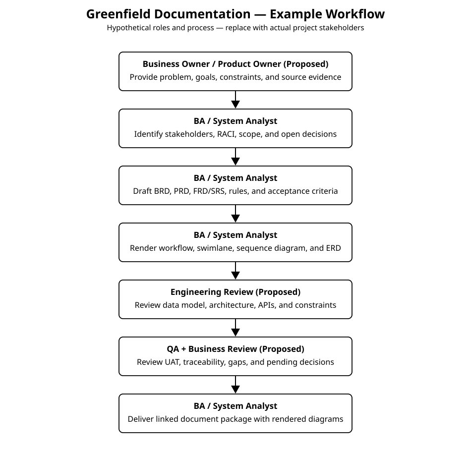
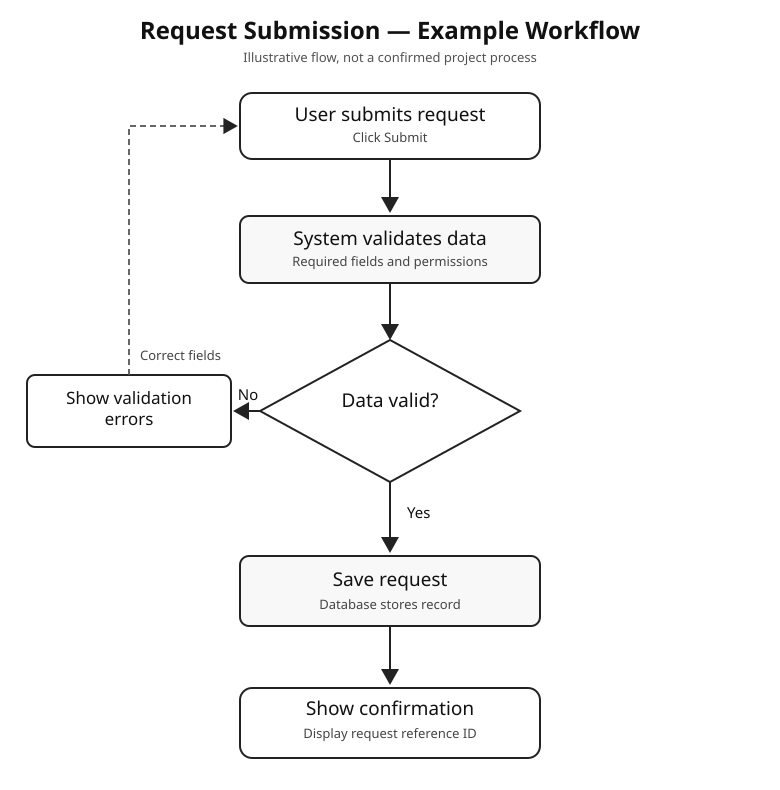
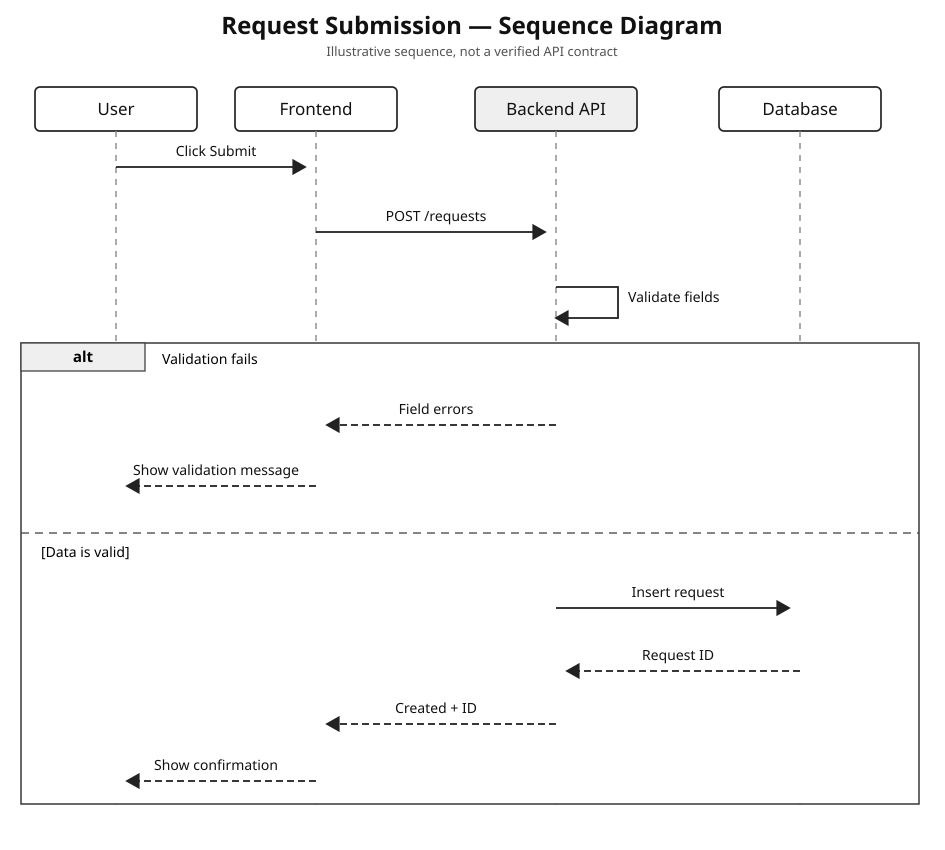
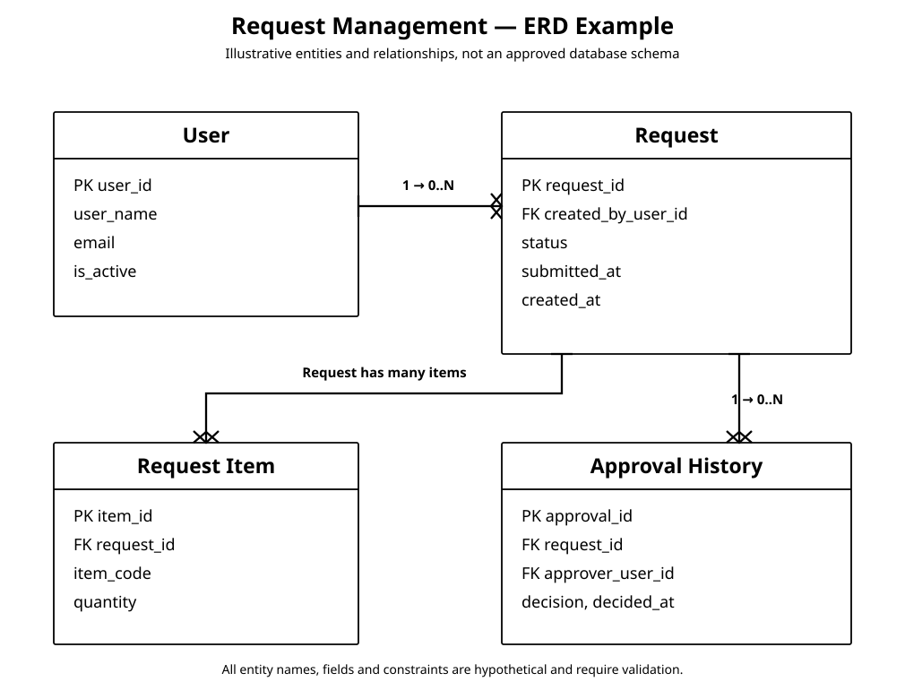

# Greenfield documentation workflow — BRD, PRD, FSD

**Default for a project, system, application, or module from scratch:** generate **three complete primary documents**, not 19 separate files.

1. `BRD` — Business Requirements Document for non-technical business readers.
2. `PRD` — Product Requirements Document for Product/PM/UI/UX and feature decisions.
3. `FSD` — Functional Specification Document for Engineering, System Analysts and QA.

Supporting analysis remains required, but it is organized **inside the appropriate document**.

[Complete three-document standard](document-suite.md) · [BRD must-have](brd-standard.md) · [PRD must-have](prd-standard.md) · [FSD must-have](fsd-standard.md)

## Workflow for the documentation package

The flow describes a hypothetical collaboration pattern, not actual named stakeholders or approvals.

1. Gather business context, source decisions, stakeholder roles and open questions.
2. Draft BRD with the business problem, outcomes, stakeholders, rules and rendered To-Be business workflow.
3. Derive PRD from the BRD. Define modules, feature inventory, user journeys, user-facing behavior and rendered User Flow.
4. Derive FSD from BRD/PRD. Specify functional logic, field validation, roles, state transitions, rendered sequence diagrams, relational ERD when applicable, integration, and test mapping.
5. Review consistency and source evidence. Label anything not yet agreed as `Proposed` or `Need Confirmation`.
6. Deliver three separately identifiable files/documents in the requested format. Do not generate unrelated cover pages or 19 individual files.

## Where the content belongs

| Supporting content | Primary location |
|---|---|
| Business Owner, Process Owner, stakeholder mapping, RACI | BRD |
| Business goals, problem, scope, business approval and high-level workflow | BRD |
| Target users, features, personas, user journey, UI and release priorities | PRD |
| Product acceptance and screen-level interaction states | PRD |
| Field specification, validation, error handling, role permissions, calculations | FSD |
| ERD, Data Dictionary, sequence diagrams and technical integration | FSD |
| Test cases and traceability from BRD/PRD to functional requirements | FSD |
| Open decisions | Within the relevant document, with one consistent decision ID if tracked across all three |

## Example traceability

| Business | Product | Functional | Test |
|---|---|---|---|
| BR-001 | PR-001 | FS-001 | TC-001 |
| BR-002 | PR-002 | FS-002 and FS-003 | TC-002 and TC-003 |

The mapping is illustrative. One business requirement can drive multiple product features and functional specifications.

## Required visual outputs

Diagrams must be **actually rendered**, not merely Mermaid syntax.

### Business workflow example (BRD)

### Sequence example (FSD)

### ERD example (FSD)

[Editable ERD source](../examples/diagrams/erd-request-management.mmd)

**ERD layout gate:** No overlapping entities, text or connectors. Visible horizontal separators between PK, FK and attributes. Expand canvas or split diagrams instead of compressing an unreadable model.

## Document formatting and metadata

All three documents use **Calibri**, **black #000000 text** throughout, white background, and full black visible table borders without shading or colored headers. Begin directly with a clear document title.

**Do not add an invented subtitle**, departmental tagline, proposed-status banner, version, target release, Product Owner, or author. Include a dedicated Document Control section only if explicitly requested or mandated by a supplied corporate template, and use only verified fields. Otherwise omit the opening metadata table even if some factual metadata is known.

## Final delivery check

- Exactly **three primary documents** for a new-system package, unless the user specifies otherwise.
- BRD is understandable to business stakeholders without implementation detail.
- PRD covers product scope, feature behavior, roles, journeys and screens.
- FSD is testable, detailed and contains relevant rendered technical diagrams.
- No imaginary existing process, owners, API contracts, data schemas or approved business rules.
- Diagrams actually exist as legible graphics, with source files as an optional extra.
- ERD has readable table sections for PK, FK and attributes and no overlap.
- No decorative subtitle/metadata under document title.
- Cross-document IDs and decisions stay consistent.

## Rule for short inputs and first-page layout

A one-paragraph new-system brief still requires substantive **BRD, PRD, and FSD**, including the relevant actual rendered diagrams, proper analysis and cross-document traceability. Work with `Proposed` design options and `Need Confirmation` decisions rather than fabricating evidence or delaying the entire package.

The first page starts with a **plain, unnumbered document title**, immediately followed by meaningful content. Do not prefix the displayed title with `01.` or duplicate any filename index. The default files are `BRD`, `PRD` and `FSD` with the requested extension, no numeric prefix. Never add an opening `Item | Keterangan` table, technical subtitle, version/status banner or invented document metadata. Place confirmed details in the actual Stakeholder, Product or Technical sections.
