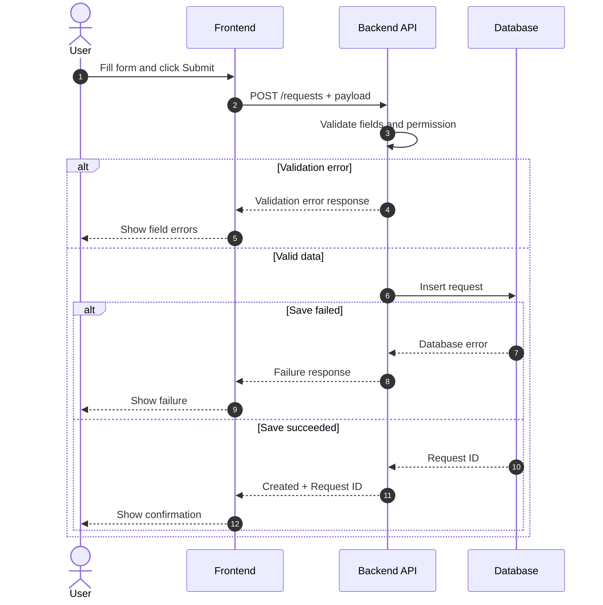
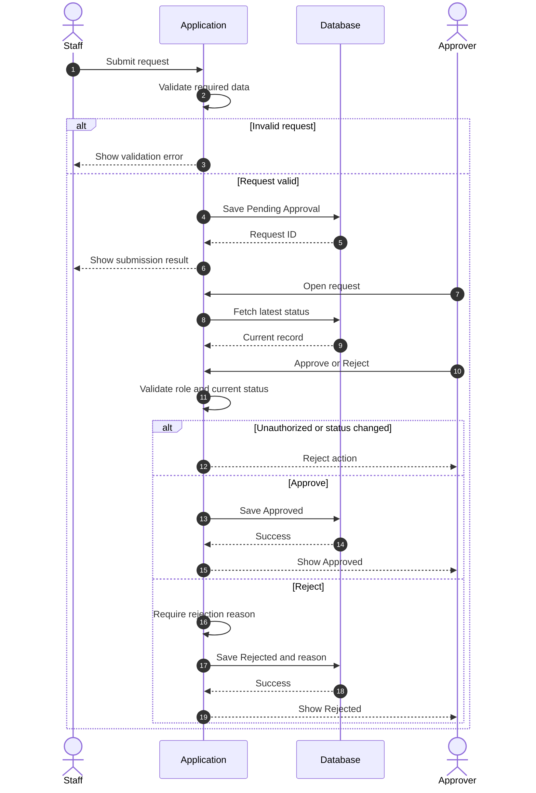
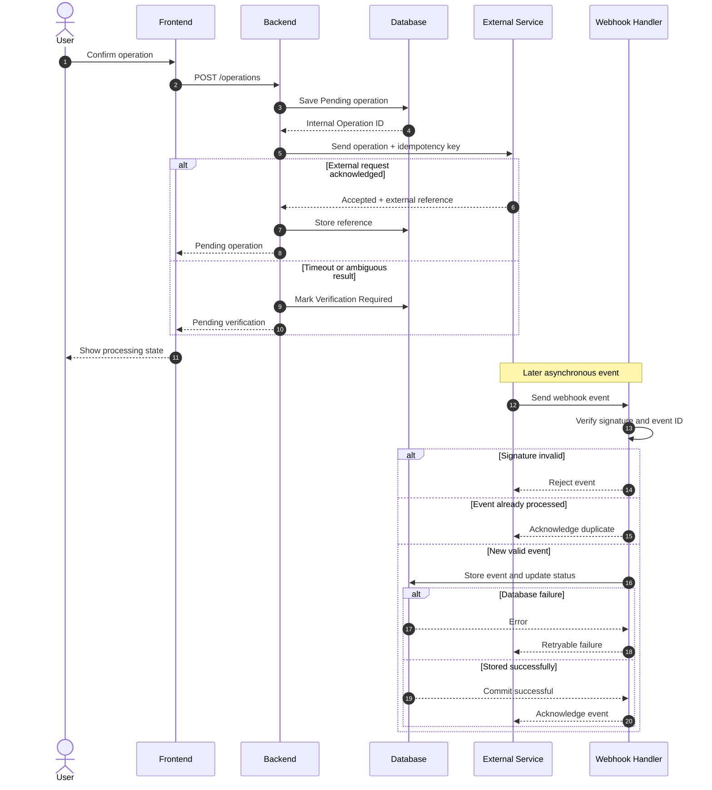

# Sequence diagrams — BA/SA reference

Use a sequence diagram when the main question is **which actor or system calls which component, in what order, and how the result is returned or processed**. This is not a replacement for a workflow diagram, a database ERD, or an API contract.

## Before drawing

Gather as much of the following as the available evidence supports: business event, actors, system boundary, endpoint and method, payload, authentication, validation, database operation, state update, response, error paths, and retry policy. For external integrations, also check idempotency, callback/webhook, status inquiry, and reconciliation.

If a contract is missing, label proposed behavior and mark the endpoint `Need Confirmation`. Do not invent a real-looking production URL.

## Notation

| Element | Use |
|---|---|
| `actor` | Human user or business role |
| `participant` | Frontend, API, DB, queue, service |
| `->>` | Request/message |
| `-->>` | Response/acknowledgment |
| `alt / else` | Mutually exclusive paths |
| `opt` | Optional action |
| `loop` | Meaningful repetition or retry |
| `Note over` | Event timing, boundaries, or a short technical note |
| `autonumber` | Readable step numbering |

Distinguish synchronous calls from asynchronous callbacks. Avoid placing a webhook directly inside the original HTTP response flow.

## Example 1 — Submit, validation, save

For this example, no specific API contract has been supplied. The endpoint and status are illustrative only.

## Example 2 — Approval workflow

This diagram illustrates a possible design. Approval role, statuses, and validation rules must be confirmed in a real project.

## Example 3 — External API plus asynchronous webhook

### Review checklist for external integration

1. Is the trigger and Source of Truth explicit?
2. Is the acknowledgment different from final business completion?
3. Are retry, timeout, and duplicate requests addressed?
4. Is webhook signature verification defined by the actual provider?
5. Is the final status mapping based on the API contract?
6. Is error handling consistent with stored state?
7. Are all sensitive values excluded from logs and examples?

## Layout and readability

Make diagrams detailed enough to be useful, but avoid compressing a long end-to-end system into a single unreadable image. Split into main request flow, callback processing, and recovery/reconciliation if needed. Keep the Mermaid source editable.

See `../examples/diagrams/` for reusable `.mmd` files.
