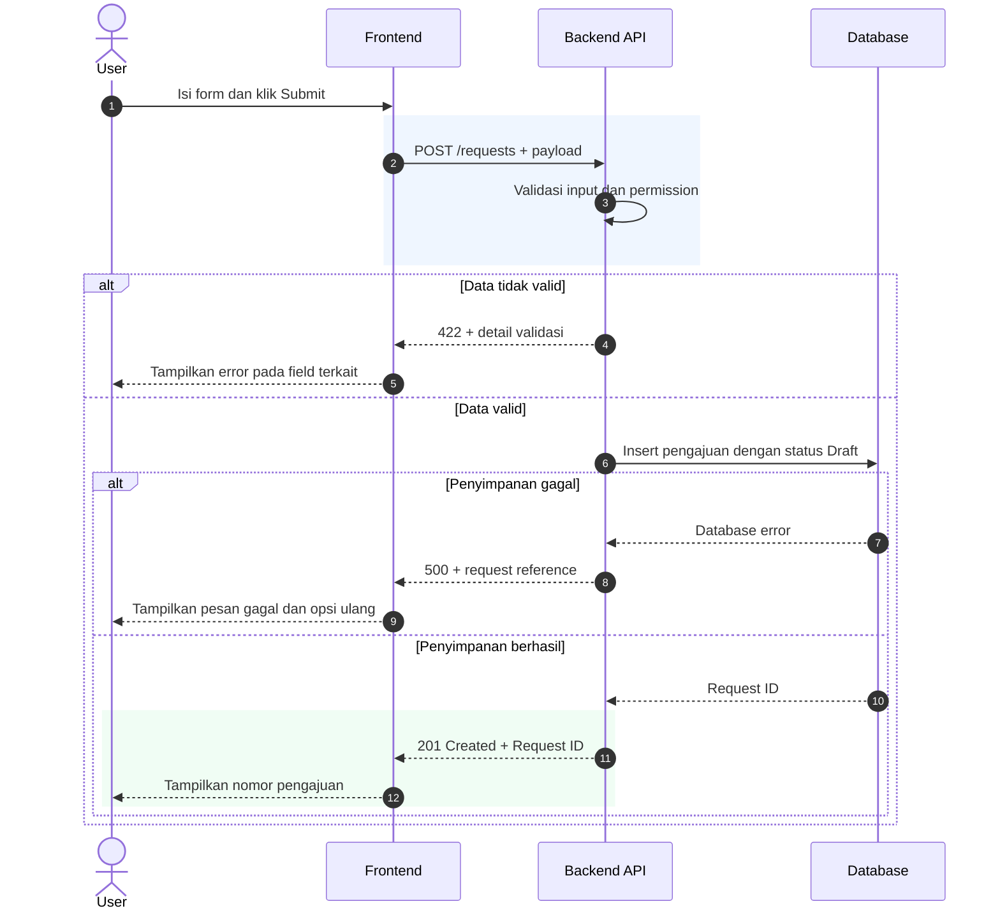
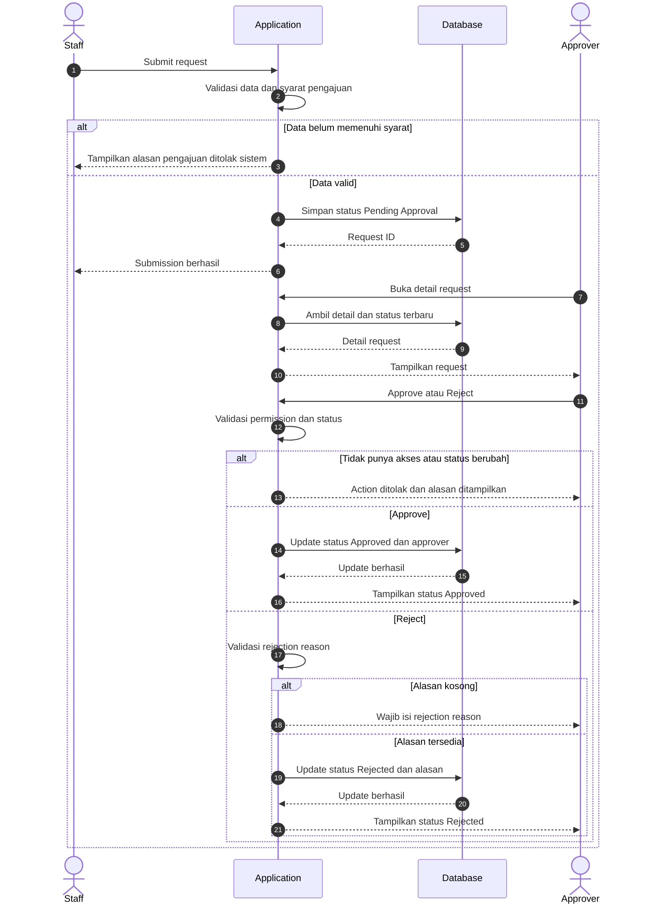
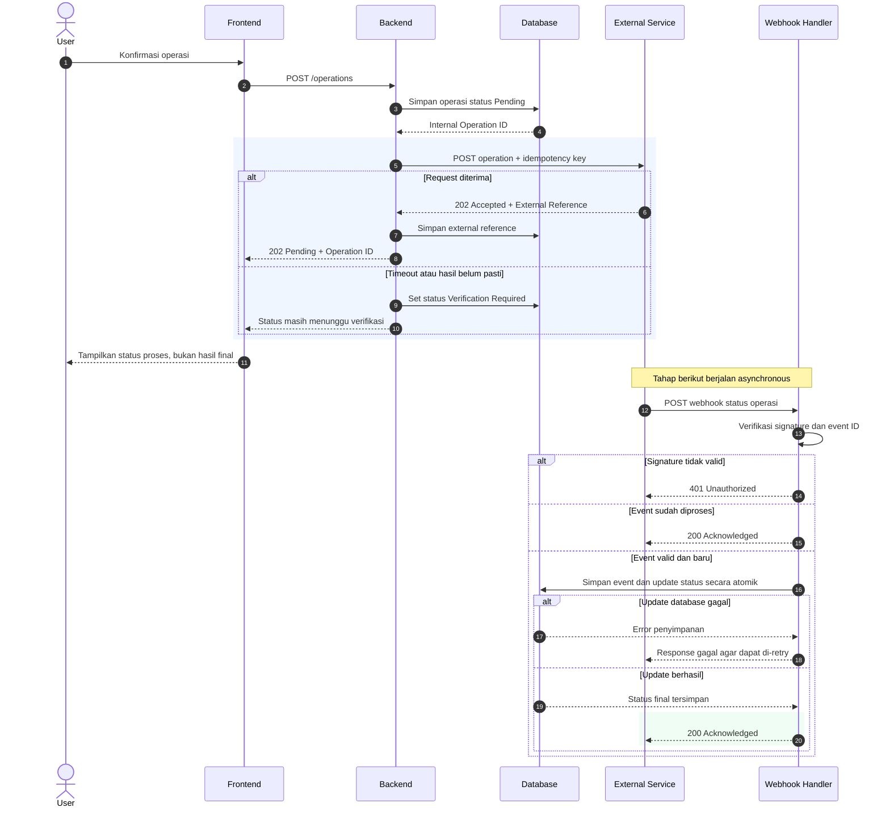

# Standar sequence diagram

`SKILL.md` bagian 8 memuat aturan lengkap dan tiga contoh end-to-end. Dokumen ini menjelaskan bagaimana membaca dan mengubah source Mermaid dalam repository.

## Kapan dipakai

Sequence diagram dipakai saat kita perlu melihat **siapa mengirim request, komponen apa yang memprosesnya, kapan data disimpan, serta kapan dan kepada siapa response dikirim**. Gunakan flowchart atau swimlane jika fokusnya urutan proses bisnis dan pembagian peran, bukan pertukaran pesan antarkomponen.

## Notasi Mermaid

| Notasi | Makna | Contoh penggunaan |
|---|---|---|
| `actor` | Manusia / peran | User, Staff, Approver |
| `participant` | Komponen / sistem | Frontend, Backend, Database |
| `->>` | Request atau message | Frontend mengirim submit request |
| `-->>` | Response, acknowledgment, callback message | Backend mengembalikan hasil |
| `alt` / `else` | Kondisi dan jalur alternatif | Approved atau Rejected |
| `opt` | Langkah opsional | Resend notification bila disepakati |
| `loop` | Perulangan yang punya batas/rule | Retry dengan ketentuan yang jelas |
| `Note over` | Konteks singkat | Callback terjadi asynchronous |

## Contoh A — Submit form

Source: [`sequence-submit-form.mmd`](../examples/diagrams/sequence-submit-form.mmd)

Alur ilustratif: User mengirim form, Backend melakukan validasi dan permission check, lalu menyimpan data. Untuk input salah, sistem menampilkan detail error. Jika database gagal, jangan klaim request tersimpan. Jika berhasil, tampilkan ID pengajuan.

## Contoh B — Approval

Source: [`sequence-approval.mmd`](../examples/diagrams/sequence-approval.mmd)

Alur ilustratif: Staff mengajukan request. Approver membuka detail, memilih Approve atau Reject. Aplikasi memeriksa permission dan status terbaru, serta meminta rejection reason saat menolak. Perubahan state harus disimpan sebelum response sukses diberikan.

## Contoh C — External API dan webhook

Source: [`sequence-external-webhook.mmd`](../examples/diagrams/sequence-external-webhook.mmd)

Tahap pertama: Backend membuat operation ID, memanggil External Service, dan memberi response sementara kepada Frontend. Response `202 Accepted` pada contoh **bukan** berarti business process selesai.

Tahap kedua: External Service mengirim webhook ke Webhook Handler. Handler memverifikasi signature dan event ID sebelum mengubah status operation. Callback yang sama dapat diterima lebih dari sekali, sehingga event duplikat harus ditangani dengan benar. HTTP response webhook hanya menandakan penerimaan callback sesuai kontrak, bukan menggantikan request awal.

## Cek diagram sebelum dipakai

- Participant sesuai arsitektur yang diketahui.
- Semua message berarah masuk akal. Frontend tidak langsung mengakses internal database kecuali memang dirancang begitu.
- Happy path dan error path penting terlihat.
- Data read/write menghasilkan perubahan status yang konsisten.
- `Request accepted` tidak disamakan dengan `business completed`.
- Webhook asynchronous berada di flow yang berbeda dari response sinkron.
- Detail endpoint, status HTTP, authentication, retry, dan idempotency dilabeli ilustrasi jika belum dikonfirmasi.
- Diagram bisa dibaca pada ukuran normal. Pecah diagram bila terlalu panjang.

## Cara menggunakan source di GitHub

GitHub mendukung render code block Mermaid dalam Markdown. Untuk preview cepat, salin isi `.mmd` ke code block `mermaid` pada file README atau dokumentasi modul. Simpan source `.mmd` agar tim bisa mengedit diagram tanpa menggambar ulang.

## Preview Mermaid lengkap

Seluruh flow berikut merupakan ilustrasi. Sesuaikan nama sistem, status, dan HTTP codes dengan requirement yang terverifikasi.

### 1. Submit form — validasi dan data tersimpan

### 2. Approval — approve, reject, permission

### 3. Integrasi eksternal — request dan webhook asynchronous

