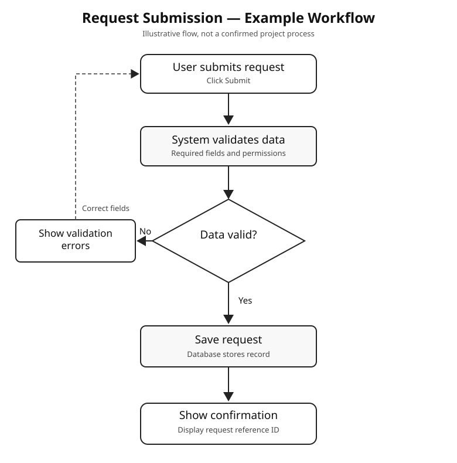
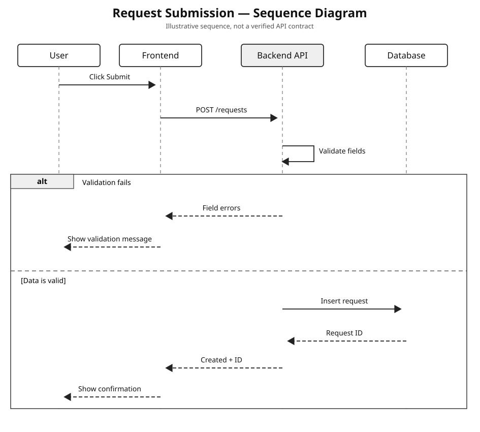
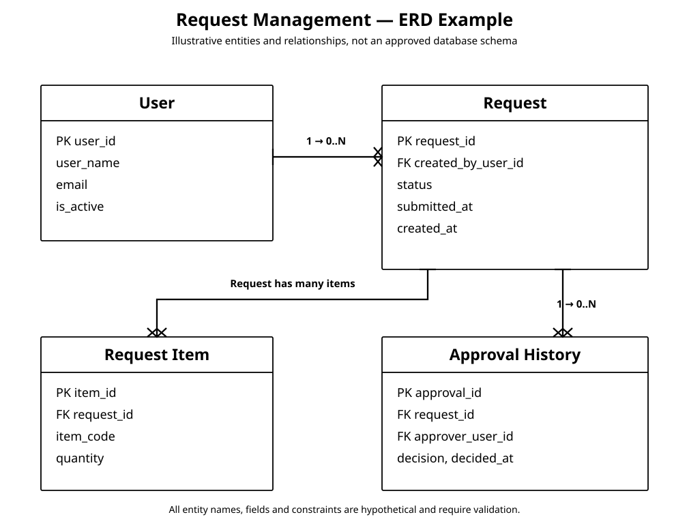

# Word and PDF formatting standard

Produce documents that resemble normal internal BA/SA work, not a decorative AI-generated brochure. Use an organization's own template if provided.

## Default page style

| Element | Default |
|---|---|
| Page size | A4 portrait |
| Margins | 2.2 cm top/bottom, approximately 2.3–2.5 cm left/right |
| Font | **Calibri** for body, headings, and tables |
| Body | 10.5–11 pt, **solid black #000000 only** |
| Line spacing | 1.1–1.15 |
| Paragraph gap | 4–6 pt after |
| Document title | 15–16 pt, left-aligned, **black #000000** |
| Section heading | 12–13 pt, bold when needed, **black #000000** |
| Table | Calibri 9–10 pt **black #000000 text**, full visible grid (0.5–0.75 pt solid black border on every cell), **white background**, no shading or color fill |
| Header and footer | Do not add unless requested |

## Non-negotiable solid-black text rules

All document text must be **pure black #000000 (RGB 0/0/0)**. This applies to body paragraphs, every heading level, document title, table headers and cells, captions, footnotes, figure labels, bullet/numbered lists, hyperlinks, and metadata.

- Do not use dark charcoal, gray subtitles, blue hyperlinks, automatic theme accents, faded caption text, conditional text colors or colored heading styles.
- In DOCX, override the font color in **Normal, Title, Heading 1/2/3, Caption, List, Hyperlink, table styles and text runs**. Do not rely on theme defaults. Hyperlinks can remain underlined but must be black.
- In PDF, verify rendered output is black and white for all text. White page, white table cells and solid black borders.
- The default font remains **Calibri** for everything.
- Text in all embedded flowcharts, sequence diagrams and ERD should also be black. The diagram's shapes may be colored only when required to convey meaning or explicitly requested. Never use faint gray labels.
- Inspect actual generated file previews to catch unexpected text-color changes before delivery.

## Non-negotiable font, table, and rendered-diagram rules

- **Font: Calibri only by default**, including title, headings, paragraphs, captions, and tables. Never silently substitute Aptos or Arial. If Calibri is unavailable, report the fallback, or honor the user's specified corporate template.
- **Tables: visible full borders on every cell** with solid black lines (about 0.5–0.75 pt). Keep every cell white with **no background color, gray header fill, alternating row shading, colored banding, or gradient**. Use black Calibri bold for column headings. Grid lines must remain visible when printed or exported.
- **Flowcharts, workflows, swimlanes, BPMN, sequence diagrams, and architecture diagrams must be delivered as rendered graphics**, not just Mermaid syntax, plain text explanations, or ASCII layouts. When the requested output is DOCX/PDF, embed the actual SVG/PNG/vector visual in the right section of the document.
- Provide Mermaid, draw.io, or SVG source as an additional editable artifact if requested or useful. Never substitute source code for a visible diagram.
- Inspect the output if tools permit. If a renderer is unavailable, state the limitation instead of claiming that a diagram is rendered.

## Avoid AI-template aesthetics

- Decorative cover pages when not requested.
- Oversized titles, cards, random icons, and brightly colored summary boxes.
- Generic introductions and conclusions added just to create extra pages.
- Starting every section on a new page without a real reason.
- Tables whose columns all have equal width despite different content.
- Converting editable tables into images.
- Diagram text so small it cannot be read at normal zoom.

## Default three-document package for a new system

When asked to document a new system, project or module from scratch, automatically produce **BRD, PRD, and FSD as three distinct primary documents**, each with its own purpose and must-have content. Supporting analysis such as stakeholders, business workflows, product journeys, sequence diagrams, ERD and UAT belongs inside the relevant document, rather than being published as 19 unrelated files.

- **BRD:** Non-technical business purpose, problems, objectives, stakeholders, scope, Business Requirements and **rendered high-level business workflow**.
- **PRD:** Product features, target users, user stories, product behavior, screen requirements, release scope and **rendered User Flow**.
- **FSD:** Functional Requirements, role permissions, validation, status changes, integration where applicable, test mapping and **rendered sequence diagrams/ERD** where relevant.

See the [three-document standard](document-suite.md) and [greenfield guide](greenfield-documentation.md). For a narrow ticket or one-field change, do not trigger all three automatically.

## Plain title and metadata rule

Start with **one plain title only**, then the actual document content. Do not add a subtitle, decorative underline, status/version banner, job-function label, colored box or ornamental header.

Specifically, do not produce a line such as:

> Product Management & System Analysis | Status: Proposed | Version: 1.0.0

Do not fabricate Product Owner, Lead System Analyst, Target Release, Sprint, document Version, document Status, author, PIC, approval or date. Add a **Document Information table only when valid metadata was given by the user/source or an approved corporate template requires it**. Do not insert placeholder metadata or duplicate the same values below the title and in a table.

## ERD visual layout gate (FSD)

- Zero overlap: no table/entity, field text, relationship line, connector or cardinality label may overlap another element.
- **Never compress** a large ERD just to fit one page. Increase SVG canvas, use landscape, or split by module and provide an overview.
- Within each table, **separate Primary Key, Foreign Key and attributes using solid visible horizontal divider lines** and explicit `PK` and `FK` labels.
- Keep relationship connectors outside table contents. Mark cardinality and reference the correct FK.
- Inspect the rendered ERD at normal zoom and fix collision, clipping and microscopic text before exporting it to Word/PDF.
- Provide editable diagram source when useful, in addition to—not instead of—the rendered graphic.

[Example ERD with separated PK/FK groups](../examples/diagrams/erd-request-management.svg)

## Example of a real rendered diagram

These SVG examples show the required visual output. They are hypothetical flows, not validated requirements for a particular system.

## DOCX requirements

Use actual heading styles, editable tables, consistent paragraph spacing, stable numbering, and meaningful page breaks. Repeat a header row when a table continues onto the next page if the tool supports it. Avoid splitting rows across pages where possible. Use a full visible black cell grid, enforce black text in every style and run, and embed requested diagrams as graphics. Use landscape for a genuinely wide page or diagram instead of shrinking everything.

## PDF requirements

Preserve correct content, alignment, and diagram readability. Check for clipped table cells, missing grid borders, unexpected shading, orphaned headings, empty pages, missing characters, and broken images after rendering. Verify each requested diagram is present as a rendered visual. Do not simply rename a file extension to PDF.

## Content quality still matters

A nice layout does not replace accurate requirements. Check actors, triggers, validation, permissions, business rules, exceptions, source evidence, and acceptance criteria before export.

For Indonesian writing, apply the [Anti-AI Slop guide](anti-ai-slop-id.md). Technical terms remain in English.

## Mandatory clean first page

- **Document title has no leading number or bullet.** Never render `01. Business Requirements Document`, `01_BRD`, `Document 1` or a numbered-list paragraph as the first-page title. Use a plain unnumbered title such as `Accounting Module — Product Requirements Document (PRD)`.
- Default file names are `BRD.docx`, `PRD.docx` and `FSD.docx`. Do not use numeric filename prefixes unless the user explicitly requests them. Even then, keep the **visible document title unnumbered**.
- After the title, go directly to the actual first section. No subtitle, faux letterhead, registration/crop-mark corners, decorative horizontal rule, divider banner, header/footer, or status/version line.
- **Never generate the introductory table `Item | Keterangan` / `Item | Description`.** Do not replace this with another generic Module/Target RDBMS/Data Architect/Target Audience/Status information table.
- This is not only about fabricated metadata. **Even real metadata should be placed in the relevant BRD/PRD/FSD section**, not automatically formatted as a generic two-column front-matter table.
- Include Document Control only if specifically requested or demanded by an actual supplied company template, using exact verified fields. The default is **no document metadata table at all**.
- A short brief about a new system is enough to generate substantive, comprehensive BRD, PRD and FSD documents. Do not pad with decorative layout or substitute outline headings for real analysis.
- Before delivery inspect the **rendered first page in white print-layout view**, and ensure this rule is met. Word dark-mode app UI is not a substitute for checking actual text color and export appearance.
